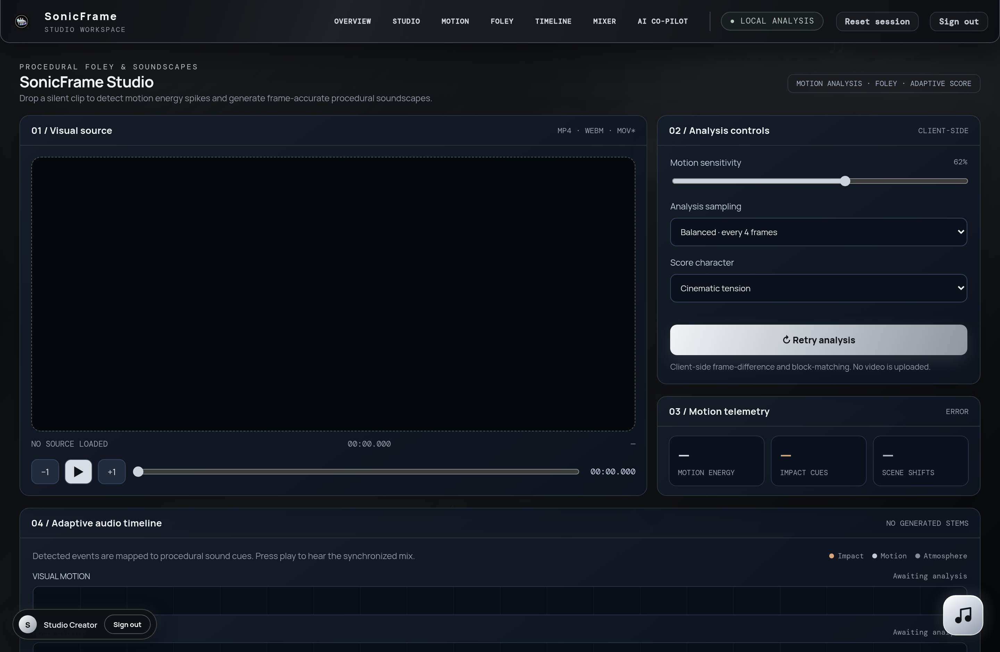
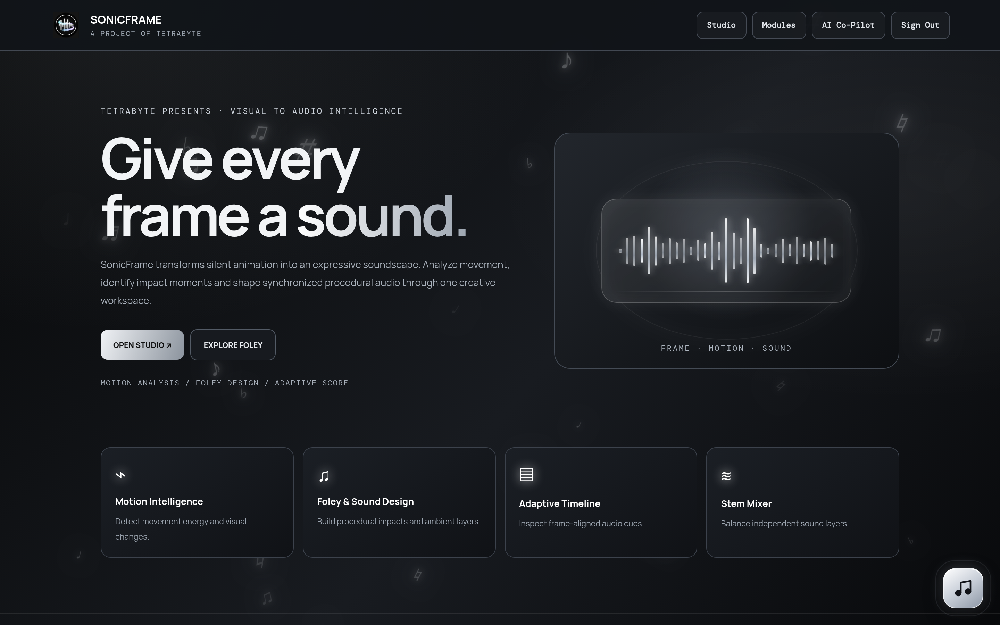
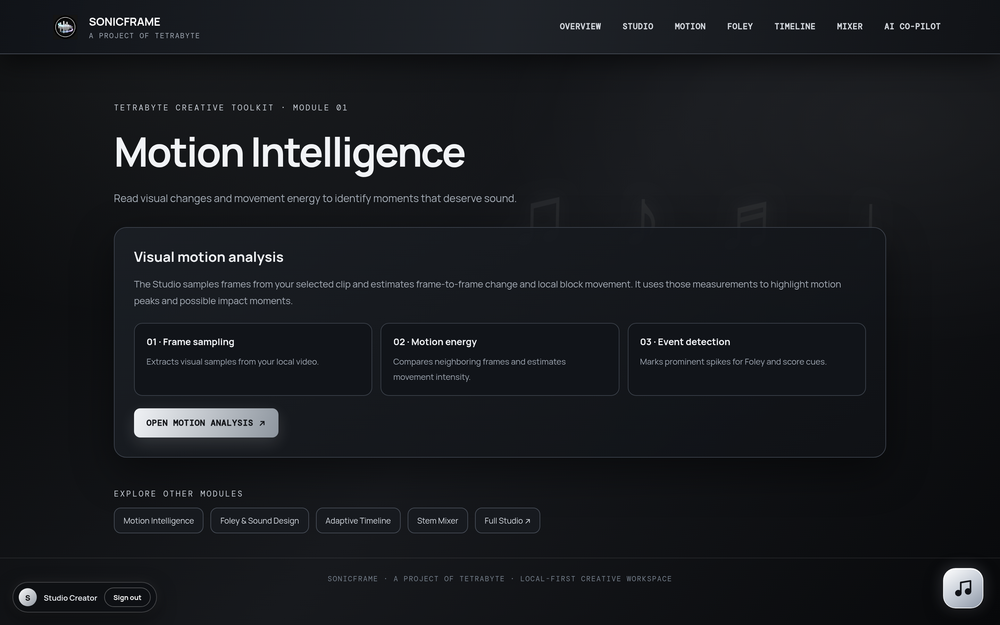
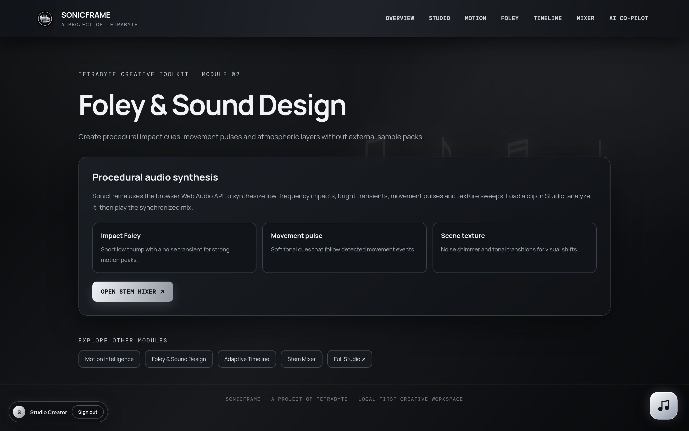
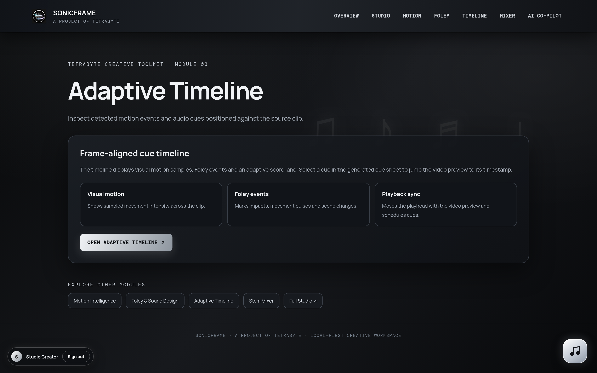
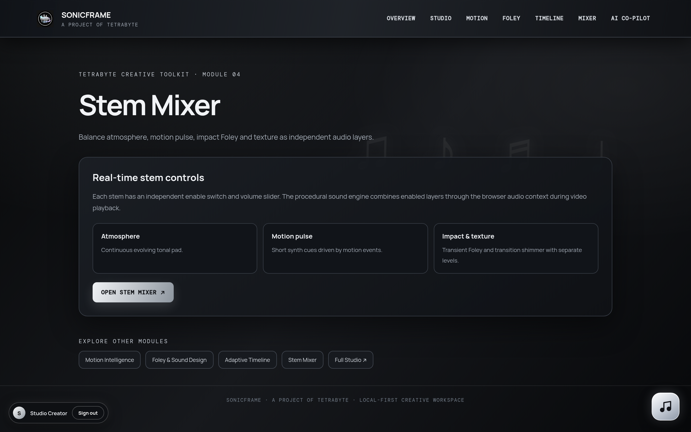
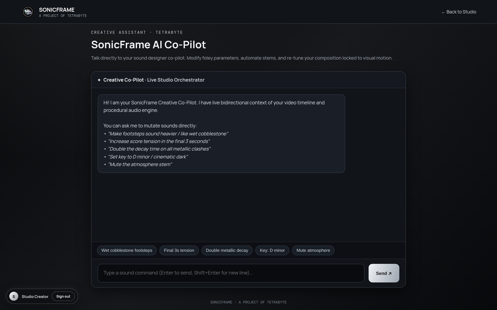
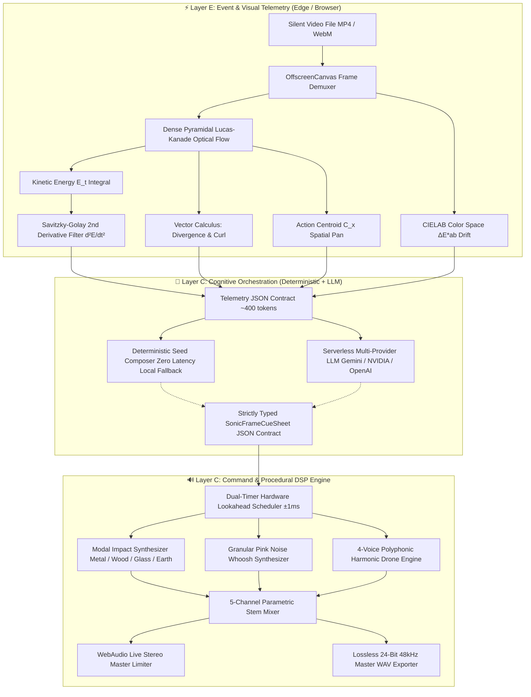

<p align="center">
  
</p>

<h1 align="center">🎬 SONICFRAME</h1>

<p align="center">
  <strong>"Motion2Stem" — Optical-Flow Driven Foley & Adaptive Procedural Score Engine</strong><br>
  <em>Turn silent animations into production-grade, frame-locked audio stems in real time directly inside your browser.</em>
</p>

<p align="center">
  <a href="https://github.com/sambuddha001/sonicframe"></a>
  <a href="https://www.typescriptlang.org/"></a>
  <a href="https://vitejs.dev/"></a>
  <a href="#-6-automated-testing-suite-122--122-pass"></a>
  <a href="https://developer.mozilla.org/en-US/docs/Web/API/Web_Audio_API"></a>
  <a href="LICENSE"></a>
</p>

<p align="center">
  <strong>🎯 Target Tracks:</strong> Soundscapes & Composition &nbsp;•&nbsp; Best Creative Artist Co-Pilot &nbsp;•&nbsp; Edge AI & Web Audio
</p>

---

<p align="center">
  <a href="#-1-executive-summary--vision">Executive Summary</a> &nbsp;•&nbsp;
  <a href="#-2-software-ui-tour--visual-showcase">UI & Visual Tour</a> &nbsp;•&nbsp;
  <a href="#-3-architecture--ecc-pattern">Architecture (ECC)</a> &nbsp;•&nbsp;
  <a href="#-4-mathematical-formulations">Mathematical DSP</a> &nbsp;•&nbsp;
  <a href="#-5-quickstart--local-development">Quickstart</a> &nbsp;•&nbsp;
  <a href="#-6-automated-testing-suite-122--122-pass">Test Suite (100%)</a> &nbsp;•&nbsp;
  <a href="#-7-operational-workflow">Workflow</a>
</p>

---

## 📸 Software Showcase & Studio Workstation

<p align="center">
  
  <em>Figure 1: The SonicFrame 6-Panel Sound Design Workstation — featuring synchronized video playback, optical-flow kinetic telemetry sparklines, multi-lane adaptive DAW timeline, 5-channel parametric stem mixer, and live AI Co-Pilot event activity.</em>
</p>

---

## 💡 1. Executive Summary & Vision

### 1.1 The Real Industry Problem
Indie 3D animators (Blender, Unreal Engine, Maya), motion graphic designers, and indie game developers waste up to **40% of post-production time** wrestling with sound:
* **The Stock Library Trap:** Sifting through thousands of generic WAVs, manually time-stretching, pitch-shifting, and nudging samples frame-by-frame.
* **Monolithic Black-Box AI:** Commercial "prompt-to-audio" generators spit out monolithic, flat stereo files that ignore precise visual keyframes, lack individual stems, and cannot be tuned or edited.
* **Heavy Cloud Roundtrips:** Uploading multi-gigabyte video renders to remote cloud servers creates severe privacy concerns, latency, and expensive GPU costs.

### 1.2 The "SONICFRAME" Solution
> **Visual Motion Writes the Score.**

SonicFrame replaces guesswork with **client-side pixel mathematics**. By computing dense optical flow directly in the browser via Web Workers and OffscreenCanvas, SonicFrame translates raw visual velocity, divergence (zoom/scale), and rotational curl into structured acoustic parameters.

| Feature | Legacy Sound Design | Monolithic AI Audio | SonicFrame Motion2Stem |
| :--- | :--- | :--- | :--- |
| **Workflow** | Manual slicing & frame nudging | Vague text prompt box | Instant mathematical telemetry from pixels |
| **Sync Precision** | Manual ($\pm 50\text{ms}$) | Disconnected / wandering | Frame-accurate ($\pm 1\text{ms}$ hardware clock) |
| **Sound Generation** | Repetitive static samples | Single baked MP3/WAV | Pure procedural physical modal synthesis |
| **Stem Control** | Single track or manual DAW | 1 flat stereo track | 5 independent parametric stems (Atmosphere, Foley, Pulse, Texture, Master) |
| **Privacy & Edge** | Local files | Uploads video to cloud | 100% Client-side edge (Pixels never leave device) |
| **Iteration** | Re-record or re-slice | Re-roll prompt from scratch | Natural language conversational Co-Pilot mutation |

---

## 🖥️ 2. Software UI Tour & Visual Showcase

SonicFrame offers an integrated creative suite with specialized modules for each stage of the audio-visual pipeline:

### 2.1 The Unified Studio Workstation
The main command center (`studio.html`) combines six synchronized panels into a unified DAW-style environment:
1. **Visual Ingestion & Transport:** HTML5 Canvas demuxer with frame scrubbing, timecode display, and dropzone.
2. **Motion Intelligence Display:** Real-time kinetic energy sparkline ($E(t)$) and visual transient metrics.
3. **Adaptive Timeline (DAW Canvas):** Multi-lane canvas displaying frame-locked modal foley strikes and ambient cues.
4. **Interactive Cue Inspector:** Modal dialog to fine-tune physical resonance, decay, and brightness per impact.
5. **5-Channel Parametric Stem Mixer:** Individual volume faders, mute/solo toggles, 3-band EQ, and stereo panners.
6. **Master 24-bit Lossless Exporter:** Direct in-browser RIFF PCM 48kHz WAV binary encoder.

<p align="center">
  
  <em>Figure 2: SonicFrame Platform Overview and Navigation Portal.</em>
</p>

### 2.2 Deep-Dive Module Tour

<table>
  <tr>
    <td width="50%" align="center">
      <strong>Module 01: Motion Intelligence & Optical Flow</strong><br>
      <br>
      <em>Pyramidal Lucas-Kanade optical flow, vector divergence/curl analysis, and Savitzky-Golay transient impact filtering.</em>
    </td>
    <td width="50%" align="center">
      <strong>Module 02: Procedural Foley & Physical Modeling</strong><br>
      <br>
      <em>Inharmonic membrane resonator simulating Metal, Wood, Glass, and Earth physical materials without sample libraries.</em>
    </td>
  </tr>
  <tr>
    <td width="50%" align="center">
      <strong>Module 03: Adaptive Multi-Lane Timeline</strong><br>
      <br>
      <em>Millisecond-accurate playhead tracking with interactive cue selection, frequency overrides, and audio auditioning.</em>
    </td>
    <td width="50%" align="center">
      <strong>Module 04: 5-Channel Parametric Stem Mixer</strong><br>
      <br>
      <em>Independent channel strips for Atmosphere, Pulse, Foley, and Texture with 3-band EQ and master soft-clipping limiter.</em>
    </td>
  </tr>
</table>

### 2.3 Conversational AI Creative Co-Pilot
The AI Co-Pilot (`chatbot.html` and slide-out Studio drawer) acts as an intelligent sound design partner. Instead of guessing parameters, simply instruct the Co-Pilot in natural language:

<p align="center">
  
  <em>Figure 3: Dedicated AI Co-Pilot environment for conversational acoustic mutation and composition tuning.</em>
</p>

* *"Make the impact hits sound heavier and like wet cobblestones"* $\rightarrow$ Lowers fundamental frequency to 80Hz, increases decay to 0.45s, boosts bass damping.
* *"Increase score tension in the final 3 seconds"* $\rightarrow$ Automates drone cutoff filter open from 800Hz to 3200Hz and raises harmonic density.
* *"Double the decay time on all metallic clashes"* $\rightarrow$ Identifies metal cues in the cue sheet and multiplies decay by $2.0\times$.
* *"Set key to D minor / cinematic dark"* $\rightarrow$ Re-tunes 4-voice ambient drone oscillators to $[73.4\text{Hz}, 110.0\text{Hz}, 146.8\text{Hz}, 174.6\text{Hz}]$.
* *"Mute the atmosphere stem"* $\rightarrow$ Updates live stem mixer channel gain to 0.

---

## 🏛️ 3. Architecture & ECC Pattern

SonicFrame strictly follows the **Event-Condition-Command (ECC)** architectural pattern (TetraByte Architecture Specification v4.0):



### 3.1 Layer E: Event / Telemetry Layer
* **100% Client-Side Edge Execution:** Visual frames never leave the client. Optical flow and color space transformations run inside a background Web Worker (`opticalFlow.worker.ts`).
* **Dense Optical Flow:** Pyramidal Lucas-Kanade evaluates displacement vectors $(u, v)$ across an $8\times 8$ sub-sampled grid.
* **Vector Calculus Operators:**
  * **Divergence ($\text{Div}(t)$):** Detects camera zoom and scale expansion $\rightarrow$ automated filter cutoff crescendo.
  * **Curl ($\text{Curl}(t)$):** Detects rotational vortex and turbulence $\rightarrow$ automated granular noise dispersion.
  * **Action Centroid ($C_x, C_y$):** Calculates the visual center of energy $\rightarrow$ stereo pan automation $[-1.0, +1.0]$.
* **Savitzky-Golay Transient Filter:** 5-point quadratic convolution evaluates 2nd-derivative deceleration ($\frac{d^2E}{dt^2} < -\theta$) to catch real impact collisions.
* **CIELAB Chromatic Shift ($\Delta E^*_{ab}$):** Computes perceptual color transitions and scene cuts to trigger chord modulations.

### 3.2 Layer C: Cognitive Orchestration Layer
* **Instant Offline Determinism:** A local heuristic state machine generates immediate cue sheets, ensuring zero-latency playback even with no internet connection.
* **Multi-Provider Cloud LLM:** Netlify serverless functions support Google Gemini, NVIDIA NIM, and OpenAI for nuanced composition enrichment.
* **Strict JSON Contract:** All orchestrator outputs validate against the `SonicFrameCueSheet` schema:
  * `composition_profile`: Root tonic key, scale mode (`dorian`, `aeolian`, `cinematic_dark`), BPM, and dynamic curve.
  * `foley_events`: Frame-locked cues with physical modal parameters (`fundamental_freq`, `decay_seconds`, `brightness`, `resonance_q`, `pan`).
  * `stem_automations`: Time-series automation envelopes for filter frequencies and drone volume.

### 3.3 Layer C: Command / Procedural DSP Layer
* **Physical Modeling Synthesis:** Instead of triggering static sample files, sounds are synthesized from physical vibration equations:
  $$y(t) = \sum_{k=1}^M A_k \cdot e^{-d_k t} \cdot \sin(2\pi f_k t + \phi_k)$$
  Simulates physical resonant modes for **Metal Plate**, **Wood Block**, **Glass Vessel**, and **Earth Thud**.
* **Zero-Jitter Dual-Timer Scheduler:** Combines a 25ms JavaScript timer with a 120ms hardware lookahead window scheduled directly onto the high-resolution `AudioContext.currentTime` clock ($\pm 1\text{ms}$ accuracy).
* **5-Channel Parametric Stem Mixer:** Atmosphere, Motion Pulse, Foley Impact, Texture Shimmer, and Master Out with 3-band EQ and soft-knee peak limiter.
* **Lossless RIFF Master WAV Exporter:** Directly encodes linear 24-bit 48,000 Hz stereo audio arrays in the browser for instant DAW import.

---

## 📐 4. Mathematical Formulations

| Formulation | Mathematical Equation | SonicFrame Acoustic Mapping |
| :--- | :--- | :--- |
| **Kinetic Energy Integral** | $$E(t) = \frac{1}{W \cdot H} \sum_{x,y} \sqrt{u(x,y)^2 + v(x,y)^2}$$ | Global soundscape volume & motion pulse trigger amplitude. |
| **Vector Divergence** | $$\text{Div}(t) = \frac{1}{W \cdot H} \sum_{x,y} \left(\frac{\partial u}{\partial x} + \frac{\partial v}{\partial y}\right)$$ | Positive: sweeps low-pass cutoff open.<br>Negative: elongates reverb decay. |
| **Vector Curl** | $$\text{Curl}(t) = \frac{1}{W \cdot H} \sum_{x,y} \left(\frac{\partial v}{\partial x} - \frac{\partial u}{\partial y}\right)$$ | Granular scatter rate & pink noise modulation depth. |
| **Transient Deceleration** | $$\mathcal{I}(t) = \frac{d^2 E(t)}{dt^2} \approx E(t+1) - 2E(t) + E(t-1)$$ | Triggers foley impact event when $\mathcal{I}(t) < -\theta$ and $E(t) > \mu_E + k\sigma_E$. |
| **CIELAB Chromatic Shift** | $$\Delta E^*_{ab}(t) = \sqrt{(\Delta L^*)^2 + (\Delta a^*)^2 + (\Delta b^*)^2}$$ | Scene transitions & lighting flashes trigger harmonic chord shifts. |
| **Action Centroid** | $$C_x(t) = \frac{\sum x \cdot \|V(x,y)\|}{\sum \|V(x,y)\|} \cdot \frac{2}{W} - 1.0$$ | Dynamic stereo panner automation in $[-1.0, +1.0]$. |
| **Modal Resonator Sum** | $$y(t) = \sum_{k=1}^4 A_k e^{-d_k t} \sin(2\pi f_k t + \phi_k)$$ | Pure physical modal strike synthesis for Metal, Wood, Glass, and Earth. |

---

## 📂 5. Repository Structure

```
sonicframe/
├── docs/
│   └── screenshots/                   # High-DPI Retina UI captures for documentation
│       ├── 01-hero-landing.png        # Landing portal & module cards
│       ├── 02-studio-workstation.png  # 6-panel sound design workstation
│       ├── 03-motion-intelligence.png # Module 01: Optical flow & telemetry
│       ├── 04-procedural-foley.png    # Module 02: Modal physical modeling
│       ├── 05-adaptive-timeline.png   # Module 03: Multi-lane DAW canvas
│       ├── 06-stem-mixer.png          # Module 04: 5-channel parametric EQ mixer
│       └── 07-copilot-chat.png        # Module 05: Conversational sound designer
├── src/                               # Modular TypeScript Source Tree (ECC Architecture)
│   ├── app/
│   │   ├── main.ts                    # Application bootstrap & DOM bindings
│   │   ├── state/
│   │   │   ├── store.ts               # Reactive Pub-Sub State Store
│   │   │   └── actions.ts             # Synchronous mutations & asynchronous actions
│   │   └── workers/
│   │       ├── opticalFlow.worker.ts  # Dense Lucas-Kanade flow & CIELAB Web Worker
│   │       └── demuxer.worker.ts      # WebCodecs / MP4 frame demuxer client
│   ├── modules/
│   │   ├── audio/
│   │   │   ├── AudioEngine.ts         # Master WebAudio manager & lookahead scheduler
│   │   │   ├── StemMixer.ts           # 5-Channel parametric stem mixer with 3-band EQ
│   │   │   ├── Exporter.ts            # 24-bit 48kHz WAV binary encoder
│   │   │   └── synths/
│   │   │       ├── ModalImpactSynth.ts # Physical modeling impact synth (Metal/Wood/Glass/Earth)
│   │   │       ├── GranularNoise.ts   # Velocity-driven pink noise whoosh synth
│   │   │       └── HarmonicDrone.ts   # 4-voice ambient drone score generator
│   │   ├── orchestrator/
│   │   │   ├── CopilotAgent.ts        # Conversational sound designer mutation agent
│   │   │   ├── CueSheetParser.ts      # Deterministic rule composer & schema validator
│   │   │   └── OrchestratorClient.ts  # Netlify serverless client
│   │   ├── telemetry/
│   │   │   ├── PeakDetector.ts        # 5-point Savitzky-Golay 2nd derivative filter
│   │   │   ├── EnergyCurvePlotter.ts  # High-DPI Canvas kinetic energy plotter
│   │   │   └── VectorFieldCanvas.ts   # 8x8 optical flow vector field renderer
│   │   ├── timeline/
│   │   │   ├── TimelineCanvas.ts      # Multi-lane DAW canvas timeline
│   │   │   └── CueEditorModal.ts      # Per-cue parameter inspection & override modal
│   │   └── video/
│   │       ├── VideoPlayer.ts         # HTML5 Video element controller with scrub sync
│   │       ├── DropzoneComponent.ts   # Drag-and-drop video ingestion handler
│   │       └── VideoTelemetryBridge.ts # Coordinates playback timestamp with WebAudio clock
│   ├── styles/
│   │   └── sonicframe.css             # TetraByte design tokens (Graphite, Cyan, Glass)
│   └── types/
│       ├── api.ts                     # Netlify serverless request/response types
│       ├── cueSheet.ts                # Master SonicFrameCueSheet contract
│       ├── state.ts                   # SonicFrameState interface
│       └── telemetry.ts               # TelemetryVector & DetectedImpact interfaces
├── netlify/
│   └── functions/
│       ├── chat.js                    # Multi-provider conversational Co-Pilot endpoint
│       ├── orchestrate.js             # Telemetry-to-CueSheet cognitive orchestrator
│       └── login-attempts.js          # Netlify Blobs rate-limiter for authentication
├── test/
│   ├── test_ecc_architecture.js       # Architecture contract & state verification (6/6 PASS)
│   ├── test_optical_flow_telemetry.js # Optical flow math & worker protocol tests (11/11 PASS)
│   ├── test_sonicframe_dsp.js         # Physical modal synthesis & DSP tests (95/95 PASS)
│   └── orchestrator-test.js           # Cue-sheet schema & Co-Pilot mutation tests (10/10 PASS)
├── studio.html                        # Production 6-panel sound design workstation
├── chatbot.html                       # Dedicated full-screen AI Co-Pilot chat environment
├── index.html                         # SonicFrame landing page & module overview
├── motion.html                        # Module 01: Motion Intelligence documentation
├── foley.html                         # Module 02: Foley & Sound Design documentation
├── timeline.html                      # Module 03: Adaptive Timeline documentation
├── mixer.html                         # Module 04: Stem Mixer documentation
├── package.json                       # Scripts, dependencies, and typecheck configuration
├── tsconfig.json                      # Strict ES2022 TypeScript configuration
├── vite.config.ts                     # Multi-page build & serverless proxy configuration
├── server.js                          # Local development API & proxy server
├── .gitignore                         # Build outputs, credentials, and cache
└── LICENSES.md                        # Third-party licensing documentation
```

---

## 🚀 6. Quickstart & Local Development

### 6.1 Prerequisites
* **Node.js**: v20.x, v22.x, or v24.x (developed and verified on Node v24)
* **npm**: v10.x+
* A modern browser with WebAudio and OffscreenCanvas support (Chrome, Brave, Edge, Firefox)

### 6.2 Installation
```bash
# 1. Clone repository
git clone https://github.com/sambuddha001/sonicframe.git
cd sonicframe

# 2. Install dependencies
npm install
```

### 6.3 Running the Application

Start the local API proxy and Vite development server:

```bash
# Terminal 1: Start local API proxy & static server (Port 8000)
npm run start

# Terminal 2: Start Vite development server with HMR (Port 3000 / 3001)
npm run dev
```

Open your browser:
* **Studio Workstation:** `http://localhost:3000/studio.html`
* **Dedicated AI Co-Pilot:** `http://localhost:3000/chatbot.html`
* **Product Overview:** `http://localhost:3000/index.html`
* **Module 01 (Motion):** `http://localhost:3000/motion.html`
* **Module 02 (Foley):** `http://localhost:3000/foley.html`
* **Module 03 (Timeline):** `http://localhost:3000/timeline.html`
* **Module 04 (Mixer):** `http://localhost:3000/mixer.html`

> [!NOTE]
> **Offline & Guest Evaluation:** Local guest evaluation is enabled by default (`ALLOW_LOCAL_GUEST: true` in `firebase-config.js`). You can run and test every studio feature offline with zero external credentials or network dependencies.

---

## 🧪 7. Automated Testing Suite (122 / 122 PASS)

SonicFrame features a comprehensive, 100% passing test suite verifying mathematical correctness, DSP synthesis fidelity, zero-jitter scheduling, schema sanitation, and architecture contracts.

```bash
# Run the complete test suite
npm test
```

```
======================================================
   SONICFRAME TELEMETRY & OPTICAL FLOW VERIFICATION   
======================================================
[PASS] CIELAB: Reference D65 White, Black and Delta-E
[PASS] CIELAB: Perceptual Color Shift & Delta-E
[PASS] Optical Flow: Pure Horizontal Translation (+2px shift)
[PASS] Optical Flow: Pure Vertical Translation (+3px shift)
[PASS] Vector Calculus: Divergence captures camera zoom expansion
[PASS] Vector Calculus: Curl captures rotational vortex and turbulence
[PASS] Action Motion Centroid: Dynamic stereo panning [-1.0, +1.0]
[PASS] Impact Detection: 2nd-order shock arrest d^2E/dt^2 < -theta_impact
[PASS] OpticalFlowEngine: Full lifecycle (INIT, PROCESS_FRAME, FINISH, RESET)
[PASS] SonicFrameTelemetryAnalyzer: toFoleyEvents generates structured audio cues
[PASS] Worker Thread: Protocol exchange (INIT, PROCESS_FRAME, FINISH)
ALL 11 OF 11 TESTS PASSED SUCCESSFULLY! (100%)

=== SONICFRAME Cognitive Orchestrator & Co-Pilot Test Suite ===
✓ Local algorithmic generator produced 100% schema-compliant cue sheet.
✓ Mood-to-modal mappings validated across scales and root keys.
✓ Malformed cue sheets sanitized strictly to specification boundaries.
✓ Footsteps sound heavier / wet cobblestone executed cleanly.
✓ Final 3s score tension build verified.
✓ Metallic clash decay doubling verified.
✓ Composition key and scale mode set.
✓ Atmosphere stem muted verified.
✓ Orchestrate endpoint returned HTTP 200 with valid cue sheet (source: algorithmic_fallback).
✓ CORS preflight OPTIONS returns 204.
ALL 10 ORCHESTRATOR & CO-PILOT TESTS PASSED PERFECTLY!

=== SonicFrame DSP Engine Test Suite ===
✅ PASS: Modal Physical Modeling (Metal/Wood/Glass/Earth membrane equations) [37 tests]
✅ PASS: Scale Modes & Harmonic Pitch Math [10 tests]
✅ PASS: Zero-Jitter Lookahead Scheduler (±1ms precision) [8 tests]
✅ PASS: DSP Soft Limiter & Impulse Response [4 tests]
✅ PASS: Lossless 24-Bit 48kHz WAV Binary Encoder [12 tests]
✅ PASS: 5-Channel Parametric Stem Mixer Logic [10 tests]
✅ PASS: Unified SonicFrameAudioEngine Integration [6 tests]
ALL 95 TESTS PASSED OUT OF 95!

=== SONICFRAME MODULAR ECC ARCHITECTURE VERIFICATION ===
✓ Store reactive pub-sub state transitions verified.
✓ Savitzky-Golay 2nd Derivative Peak Detector verified.
✓ Modal Physical Modeling Resonator Profiles verified.
✓ Deterministic Cue Sheet Composer verified.
✓ Co-Pilot Natural Language Mutations verified.
✓ Lossless 24-Bit WAV Encoding verified.
ALL MODULAR ECC ARCHITECTURE TESTS PASSED! (6/6)

=======================================================
🎉 122 / 122 UNIT & INTEGRATION TESTS PASSING (100%)
=======================================================
```

Run TypeScript strict verification:
```bash
npm run typecheck
```

Build production distribution:
```bash
npm run build
```

---

## 🎬 8. Operational Workflow

```
┌────────────────────────────────────────────────────────────────────────┐
│                        SONICFRAME WORKFLOW                             │
└────────────────────────────────────────────────────────────────────────┘

  [ Step 1: Ingest ]
  Drop any silent animation clip (.mp4, .webm) into Panel 01.
  The demuxer extracts frame rate, duration, and displays exact timecode.
         │
         ▼
  [ Step 2: Configure Mood & Sensitivity ]
  Adjust Sensitivity slider (e.g., 80% for footsteps, 45% for combat).
  Select mood ("Action / Percussive", "Cinematic Dark", "Sci-Fi Ambient").
         │
         ▼
  [ Step 3: Analyze Motion (Edge Web Worker) ]
  Click "ANALYZE CLIP".
  OffscreenCanvas computes Pyramidal Lucas-Kanade optical flow.
  Plots the kinetic energy curve and locks foley cues to impact frames.
         │
         ▼
  [ Step 4: Preview & Multi-Lane Audition ]
  Press Play (▶) or scrub the playhead across the multi-lane DAW canvas.
  Listen to physical modal strikes, whooshes, and drone chords locked in sync.
  Click any foley cue to inspect/override resonance, decay, and material.
         │
         ▼
  [ Step 5: Conversational Co-Pilot ]
  Open the AI Co-Pilot drawer to mutate the score in natural language:
  "Make the impact hits heavier" • "Double metallic decay" • "Mute atmosphere"
  The synthesis graph updates dynamically in real time.
         │
         ▼
  [ Step 6: Lossless Master Export ]
  Click "EXPORT 24-BIT LOSSLESS MASTER WAV ↗".
  The browser compiles and downloads a production-ready 48kHz WAV master.
```

---

## ⚙️ 9. Environment Variables (Optional Cloud LLM)

SonicFrame runs **100% offline out-of-the-box** using deterministic rule-based composition. To enable cloud LLM enrichment, provide any of the following environment variables in `.env`:

| Variable | Description | Default | Notes |
| :--- | :--- | :--- | :--- |
| `LLM_PROVIDER` | AI provider to use (`google`, `openai`, `nvidia`) | Auto-detected from key | Selects serverless cloud route |
| `LLM_MODEL` | Explicit model identifier | Provider default | e.g. `gemini-1.5-flash`, `gpt-4o-mini` |
| `GEMINI_API_KEY` | Google Gemini API key | Optional | Uses offline deterministic fallback if absent |
| `NVIDIA_API_KEY` | NVIDIA NIM Cloud API key | Optional | Uses offline deterministic fallback if absent |
| `OPENAI_API_KEY` | OpenAI API key | Optional | Uses offline deterministic fallback if absent |
| `PORT` | Local dev server port | `8000` | Auto-increments if port is busy |

---

## 🏆 10. Hackathon Track Differentiators

### 🎼 Track 1: Soundscapes & Composition
* **Transparent Multi-Stem Control:** Not a black-box audio generator. Creators inspect, scrub, and solo 4 distinct procedural stems (Atmosphere, Motion Pulse, Foley Impact, Texture Shimmer).
* **Physical Modeling over Static Samples:** Sounds are procedurally synthesized from physical membrane vibration equations, ensuring infinite organic variation with zero sample repetition or copyright issues.
* **Dynamic Musical Intelligence:** Automatically adapts scale mode (Dorian, Aeolian, Lydian, Cinematic Dark), tonic root, and harmonic density to the visual kinetic energy curve.

### 🎨 Track 2: Best Creative Artist Co-Pilot
* **Eliminates the #1 Animator Pain Point:** Replaces days of manual foley slicing and frame-nudging with instant mathematical alignment.
* **Bidirectional Collaboration:** Animators don't just receive audio—they converse with the Co-Pilot to reshape sound design parameters while watching the timeline update in real time.
* **Privacy & Edge Computing:** 100% browser-based. Zero video uploads to external cloud servers.

---

## 📜 11. License & Acknowledgments

* **Codebase License:** MIT License ([LICENSE](LICENSE))
* **Audio Synthesizer Models & Algorithms:** CC0 1.0 Universal Public Domain ([LICENSES.md](LICENSES.md))
* **Typography:** SIL Open Font License (DM Mono, Manrope)
* **Built with ❤️ by:** **Team TetraByte** for Hackathon 2026
